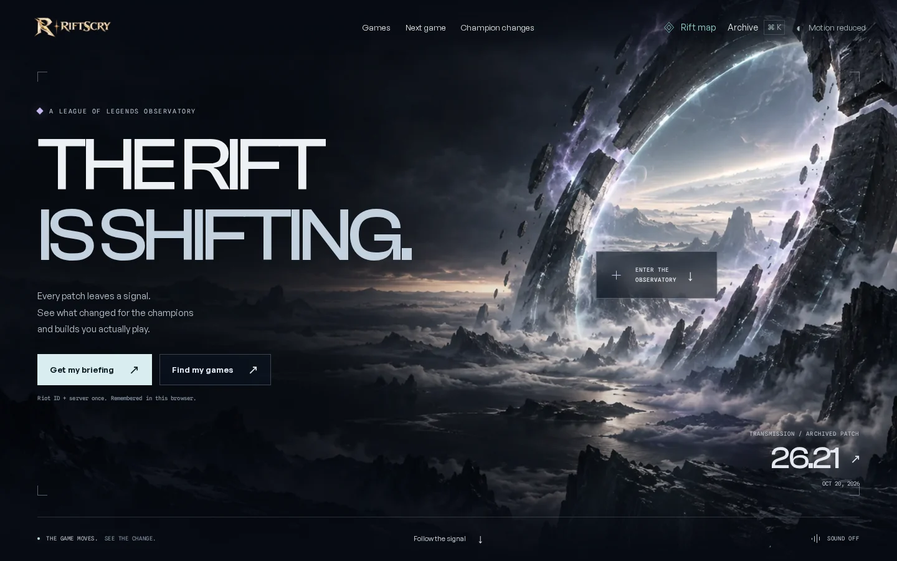

<p align="center">
  
</p>

<h3 align="center">The Rift is shifting.</h3>

RiftScry is a League of Legends companion that turns available match history into
an automatic briefing. Enter a Riot ID once, then return for the useful details:
what changed since you played, how your latest session went, and one thing to review.

- **A cinematic observatory:** an original fractured horizon, restrained atmospheric
  motion, and three connected chapters take you from a champion's signal to its
  impact and your next move. Champion artwork, exact evidence, and the archive link
  respond together. Sound is opt-in; reduced motion and static fallbacks keep the
  experience usable. The same visual world continues through every destination,
  with compact page openings, direct task controls, and one shared navigation.
- **A useful first visit and a faster return:** the homepage shows real, source-linked
  archive examples before a player lookup. Returning visitors get their selected
  player's briefing, matches, builds and catch-up links together, without a homepage
  match-history request.
- **Automatic briefing:** `/next-game` discovers recent champions, exact queues and
  recorded loadouts from imported games. It assembles a session recap and a focus
  supported by available evidence. No notes, saved cards or reflections are required.
- **Personal patch catch-up:** compare each recent champion's latest imported game
  against newer archived champion and verified item changes, with before/after
  records and source links. Unknown patch baselines remain unknown.
- **Personal patch impact:** `/next-game#impact` recalculates supported differences
  for the final items in that imported game using exact historical item references.
  Compare listed stats, total shop prices, reviewed damage components and cooldown
  scenarios, with formulas and sources. No build entry is needed. Standard
  Summoner's Rift calculations are distinct from other modes' archived changes.
- **Recent games and builds:** exact-mode history, automatically grouped observed
  loadouts, match facts, and optional timeline or AI-assisted review. The sample is
  bounded; it is not a complete season history or a global build recommendation.
- **Champion archive:** structured changes, your optional champion pool, comparisons,
  and the immersive archive journey at `/explore`.
- **Existing notebook and Build Memory:** previously saved preparation remains at
  `/notebook`; player-scoped item adjustments remain in Build Memory. These optional
  records are independent of the automatic briefing.

A successful lookup remembers the recent player on this browser when storage is
available. Direct player links still work without storage. There is no automatic
cross-device account sync or ownership verification. Automatic results require exposed
match history; Riot currently keeps ARAM: Mayhem history private, so the site explains
that gap instead of inventing a report or substituting ordinary ARAM.



## Run it

```bash
pnpm install
pnpm dev
```

`pnpm build` creates Astro/Vercel output: prerendered archive and briefing shells,
plus server-rendered player routes and the protected player API. A static file server
alone cannot serve the player API or populate an automatic briefing. The existing
Vercel Git integration builds previews for PRs and production from `main`.

## How it works

Official Riot patch notes are parsed into schema-validated JSON in
`src/data/patches/*.json`. Astro uses that committed archive to build pages and serialize
relevant patch records. React islands personalize the experience after hydration.

The briefing imports up to 20 recent match IDs using the existing player API and loads
details in bounded batches. A deterministic model derives session groups, recent
champions, patch catch-up and a review focus. Personal comparisons keep the same
champion, exact queue, role and patch. A sparse sample produces a factual recap rather
than a performance claim. Session grouping uses an explicit 90-minute gap estimate.

While visible, the briefing checks for updates every two minutes and when the player
returns after that interval. Cached data may persist for up to two minutes. History
errors and rate limits pause automatic checks; an explicit Refresh can retry them.
The briefing does not request AI reviews, timelines, ranks or summoner profiles.

`/api/player/*` validates access and identifiers, budgets Riot requests, caches records,
and returns private/no-store responses. Production player access requires the configured
Riot access mode, server-side credentials and Redis cache/budget state; see
[the player release notes](docs/player-release.md). Never expose credentials to the
client or commit deployment environment files.

- [Architecture](docs/ARCHITECTURE.md) — archive, automatic briefing, player API and optional notebook
- [Cinematic observatory](docs/cinematic-observatory/README.md) — research, visual direction, interaction design and release verification
- [Cinematic continuity](docs/cinematic-everywhere/README.md) — all-page simplification, route coverage, responsive captures and verification
- [Homepage refresh](docs/homepage-refresh/README.md) — newcomer and returning-player paths, archive examples and responsive audit
- [Automatic briefing release audit](docs/automatic-briefing/README.md) — behavior, boundaries and verification
- [Personal patch impact](docs/personal-patch-impact/README.md) — calculations, coverage, sources and verification
- [Data & methodology](docs/DATA.md) — schema, classification and provenance
- [Contributing](CONTRIBUTING.md) — checks and contribution workflow

## Commands

| Command | What it does |
|---|---|
| `pnpm dev` | Dev server |
| `pnpm build` | Astro/Vercel production build |
| `pnpm check` | Typecheck Astro and TypeScript |
| `pnpm test` | Unit tests and schema validation of committed patch data |
| `pnpm e2e` | Playwright shared browser suite (build first) |
| `pnpm exec playwright test --config=playwright.player.config.ts` | Player and automatic briefing integration against the dev server |
| `pnpm ingest 26.17` | Ingest a patch from the official notes |
| `pnpm ingest --validate` | Re-validate committed patch files offline |

## Legal

RiftScry is not endorsed by Riot Games and does not reflect the views or opinions of Riot
Games or anyone officially involved in producing or managing Riot Games properties. Riot
Games and League of Legends are trademarks or registered trademarks of Riot Games, Inc.
Champion imagery via Riot's [Data Dragon](https://developer.riotgames.com/docs/lol#data-dragon).
Code is [MIT](LICENSE); normalized patch data derives from Riot's official patch notes,
with a source link recorded in every patch file.
