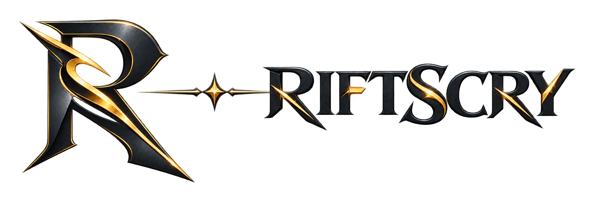
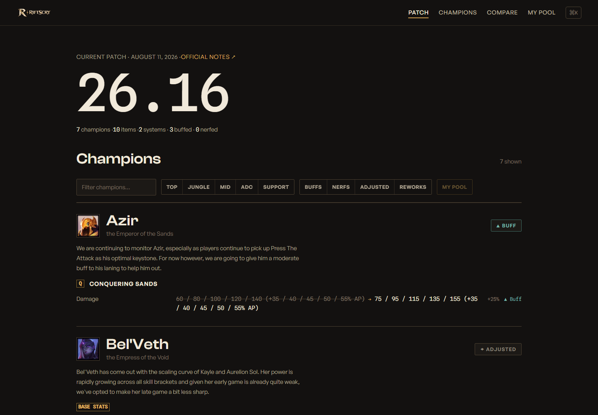

<p align="center">
  
</p>

<h3 align="center">Review your games. Prepare for the next.</h3>

RiftScry is a personal League of Legends companion. Review recent matches, keep useful
loadouts and reminders, and revisit the changes affecting the champions you play.

- **Matches and builds:** Riot-backed recent history, exact-mode filters, recorded
  loadouts, and match review with linked evidence. The imported sample is bounded;
  it is not a complete season history or a global build recommendation.
- **Next game / Rift Recall:** choose a champion, exact queue, and situation. Recall
  your own relevant notes and saved loadout, review newer archive records, choose
  one focus, then reflect afterward. Each card preserves what you originally chose.
- **Quick notes and preparation backups:** save a short reminder without needing a
  match or tracked item. Export/import your preparation to transfer it between browsers.
- **Build Memory:** maintain separate, player-scoped item adjustments with explicit
  comparison conditions and later-game evidence.
- **Champion changes:** structured before/after patch records, your champion pool,
  source links, and comparisons through the committed archive. The immersive archive
  journey remains at `/explore`.

Preparation lives in the current browser. There is no automatic device sync or account
ownership verification. Manual notes and preparation also work when match imports are
unavailable, including ARAM: Mayhem's currently private Riot history.



## Run it

```bash
pnpm install
pnpm dev
```

`pnpm build` creates the Astro/Vercel output: prerendered archive and preparation pages,
plus server-rendered player routes and the protected player API. A static file server
alone cannot serve the player API. The existing Vercel Git integration builds previews
for PRs and production from `main`.

## How it works

Official Riot patch notes → parsed into normalized, schema-validated JSON
(`src/data/patches/*.json`, one file per patch, committed to git) → Astro prerenders the
archive. React islands personalize the experience after hydration. The Next game
workspace makes no Riot player-data or AI requests; its patch context is built from that archive.

Player routes call `/api/player/*`, which validates access and identifiers, budgets
Riot requests, caches records, and returns private/no-store responses. Optional AI
reviews are requested explicitly and retain deterministic fallbacks. Production player
access requires the configured Riot access mode and server-side credentials; see
[the player release notes](docs/player-release.md). Never expose those credentials to
the client or commit deployment environment files.

- [Architecture](docs/ARCHITECTURE.md) — archive, player API, browser preparation, deployment
- [Data & methodology](docs/DATA.md) — schema, deterministic buff/nerf classification, provenance
- [Contributing](CONTRIBUTING.md) — fix a patch with a five-line PR

## Commands

| Command | What it does |
|---|---|
| `pnpm dev` | Dev server |
| `pnpm build` | Astro/Vercel production build |
| `pnpm check` | Typecheck Astro and TypeScript |
| `pnpm test` | Unit tests + schema validation of all committed patch data |
| `pnpm e2e` | Playwright end-to-end suite (build first) |
| `pnpm exec playwright test --config=playwright.player.config.ts` | Player routes and preparation integration tests against the dev server |
| `pnpm ingest 26.17` | Ingest a patch from the official notes |
| `pnpm ingest --validate` | Re-validate committed patch files (offline) |

## Legal

RiftScry is not endorsed by Riot Games and does not reflect the views or opinions of Riot
Games or anyone officially involved in producing or managing Riot Games properties. Riot
Games and League of Legends are trademarks or registered trademarks of Riot Games, Inc.
Champion imagery via Riot's [Data Dragon](https://developer.riotgames.com/docs/lol#data-dragon).
Code is [MIT](LICENSE); normalized patch data derives from Riot's official patch notes,
with a source link recorded in every patch file.
