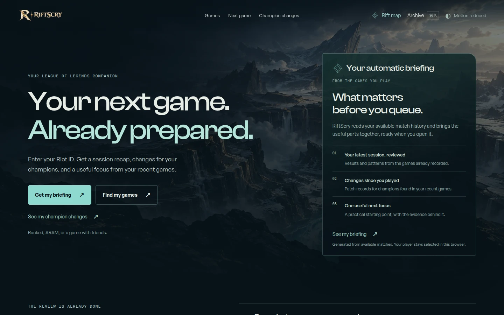
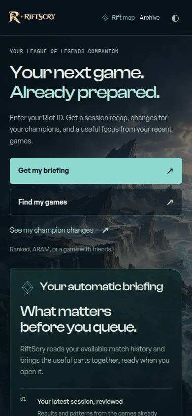
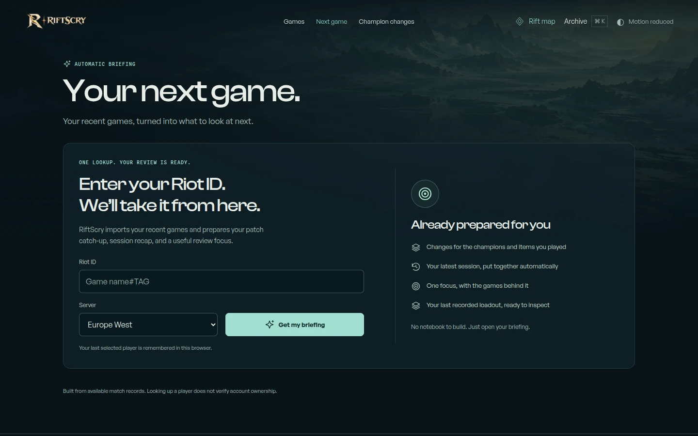
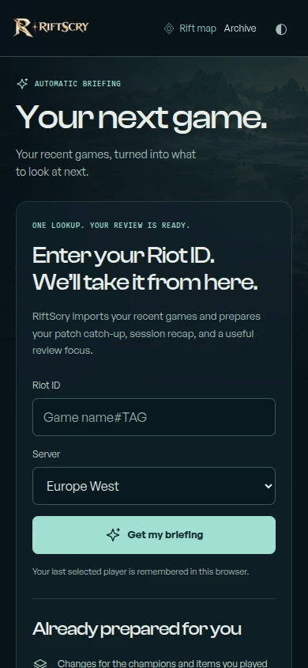
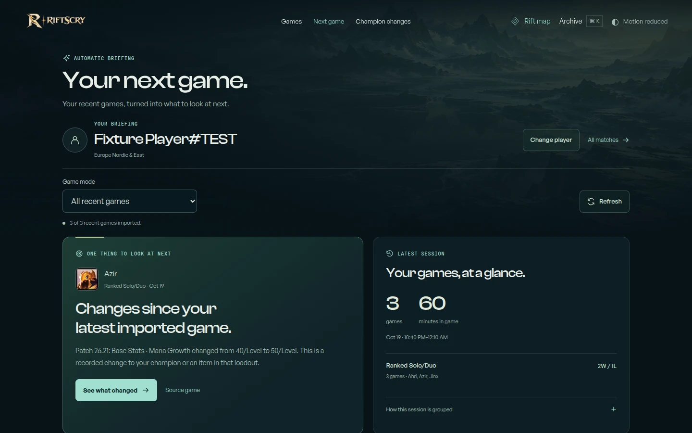
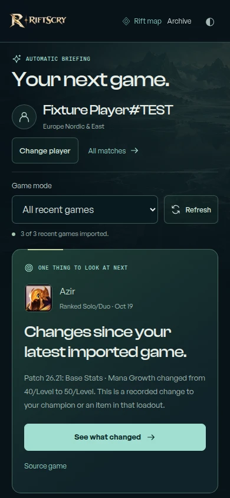

# Automatic briefing release audit

## Product correction

**Your next game. Already prepared.** RiftScry now prepares the useful output after
player lookup. The central workflow no longer asks players to write reminders, save a
loadout, build a card or submit a reflection before receiving value.

`/next-game` imports the available recent sample and automatically assembles:

1. A latest-session recap, with results separated by exact queue and recorded time played.
2. Personal patch catch-up for recent champions and verified items since each context's
   latest imported game, including numeric before/after records where available.
3. One review focus supported by patch evidence or comparable personal matches, with a
   factual recap when there is insufficient evidence for a comparison.
4. The observed final loadout and applicable runes from the relevant source match.

Successful lookup remembers the recent player on this browser. Explicit briefing links
from profiles, builds and match review preserve platform, PUUID and optional exact mode
and champion. Returning visitors can open their briefing directly; blocked storage does
not prevent a report reached through lookup or an explicit link.

The homepage now introduces these automatic outputs. The old manual preparation UI
moves to `/notebook` using its original storage key. Existing records remain available,
and the previous [companion release audit](../companion-release/README.md) is historical.

## Research grounding

[OP.GG documents an automatically activated pick page and champion patch summaries](https://help.op.gg/hc/en-us/articles/48465746492313-Checking-information-on-the-OP-GG-pick-page).
[Mobalytics documents automatic post-game insights](https://mobalytics.gg/lol/guides/mobalytics-beginners-guide).
The design choice here is a browser briefing anchored to the player's actual imported
matches and their corresponding patch baselines. This release makes no exclusivity or
win-rate-improvement claim.

[Riot's developer documentation](https://developer.riotgames.com/docs/lol) distinguishes
public APIs from local client APIs and explains versioned static data. This release
uses existing public player-data boundaries and the committed patch archive; it does
not introduce a desktop client or hidden live-game information.

## Honest data boundaries

- History is a bounded sample of at most 20 recent IDs with partial failures visible.
- Sessions use a 90-minute gap between the previous recorded end and next start.
  Grouping is an estimate inside the selected mode/sample; it is not a tilt assessment.
- Personal comparisons keep champion, queue, role and patch compatible. No global skill
  grade, loss-cause claim, next-champion prediction or "best build" is generated.
- The archive and verified item mapping are partial. Missing baselines stay unknown.
  Data Dragon names are used only when metadata matches the source game's patch.
- Mayhem's exposed history remains unavailable in normal public imports. The page
  explains this limit; it does not fabricate a report or swap in ordinary ARAM.
- Briefings check for updates every two minutes while visible, with existing cache,
  cooldown and error handling. There is no background desktop monitoring.
- No AI review, timeline, rank or summoner-profile request is needed by the briefing.
  Existing notebook text is not used to generate it.

## Mobile and visual audit

Homepage and navigation were checked at 320×568, 390×844, 568×320, 768×1024,
844×390, 1024×768, and 1440×900. All seven map destinations fit without internal
scrolling at the tested normal text sizes. No horizontal overflow, homepage player-data
requests, or page errors were observed. Entry/report checks additionally verified 16px
fields and controls at least 44px high at 320px. Loaded-report spacing was corrected
so the first automatic focus starts at 397px on a 320×568 phone; its heading visibility
is covered by the browser suite.

These exact-viewport captures use settled fonts and synthetic public-match fixtures.
They contain no private player history. The previous homepage can be compared in the
[preceding release audit](../companion-release/README.md).

| Screen | Desktop, 1440×900 | Phone, 390×844 |
| --- | --- | --- |
| Homepage |  |  |
| Lookup |  |  |
| Prepared report |  |  |

## Verification

| Local release gate | Result |
| --- | --- |
| Astro / TypeScript check | 0 errors, 0 warnings; two existing hints |
| Unit and integration suite | 458 passed across 46 files |
| Vercel production build | Passed |
| Player browser workflows | 48 passed |
| Production-build desktop and mobile Chromium suite | 185 passed; 13 existing conditional skips |
| Automatic briefing and homepage workflows | 46 executions passed inside the shared suite |
| Patch whitespace | Passed |

The automatic workflow coverage includes lookup and return, patch changes, exact modes,
partial and unavailable data, blocked storage, invalid identity, player switching,
delayed responses across tabs, automatic visible-page updates, and the narrow-screen
first-result position. Existing notebook tests moved with the route; their stored-data
and backup coverage remains active. Hosted CI also runs mobile WebKit. The release PR
records final CI and authenticated Vercel verification. These are browser-emulation and
viewport checks, not physical-device testing.
