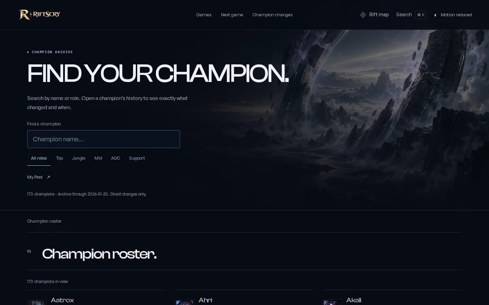
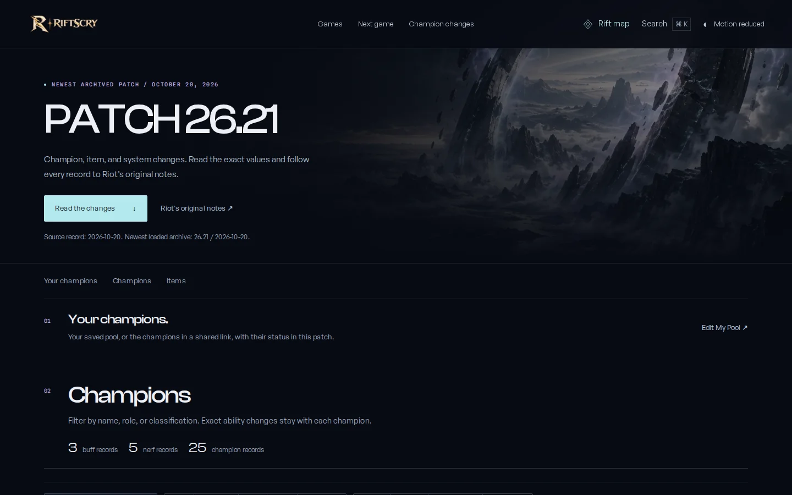
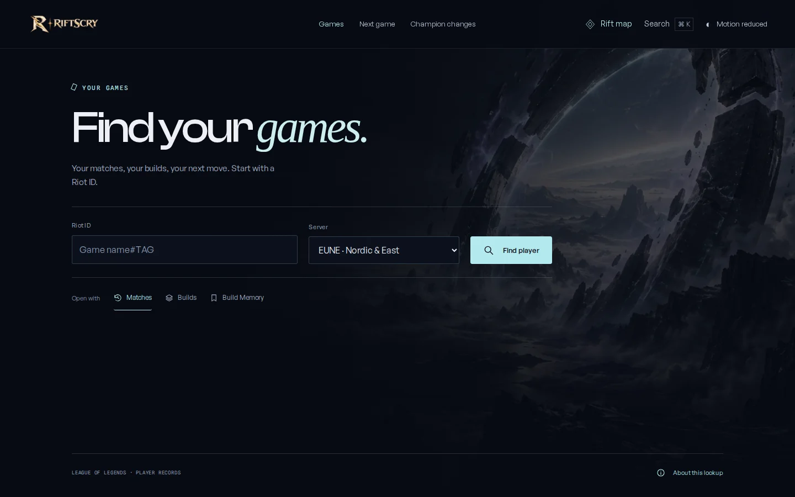
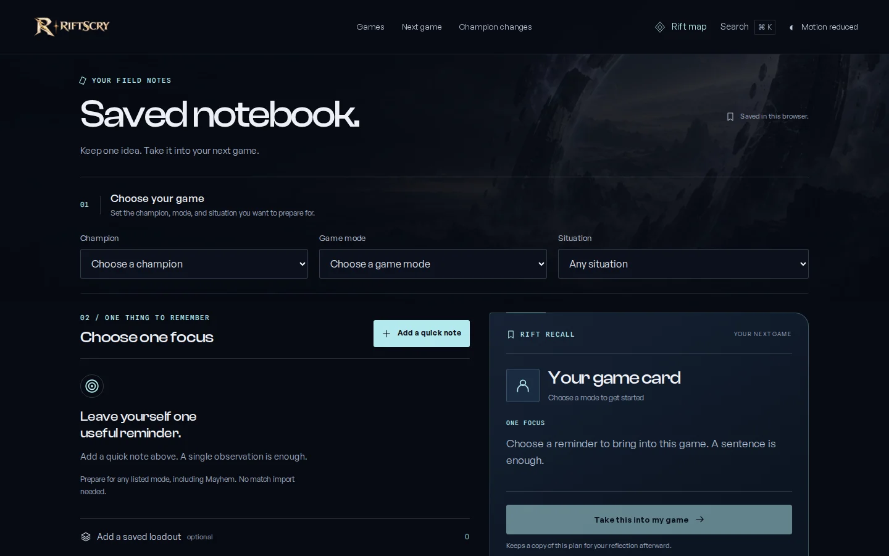
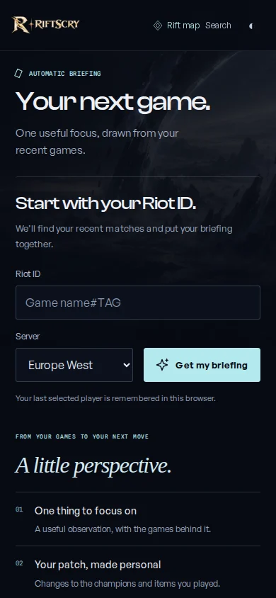
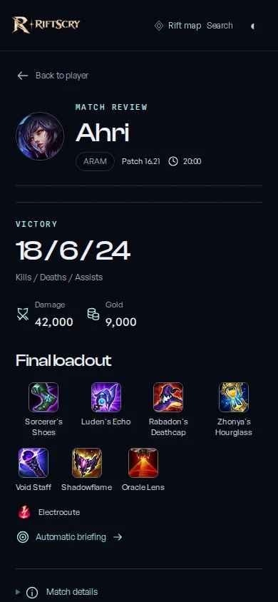

# One observatory, every destination

The homepage established RiftScry's visual world. This continuation carries it into
the actual work: finding games, reading patch evidence, keeping champions, preparing
a briefing, and saving a thought for later.

The design direction and research remain documented in the
[cinematic observatory study](../cinematic-observatory/README.md). This release focuses
on continuity and ease of use across the site.

## Design decisions

**One shared navigation.** Every rendered page uses the same compact header, with
Games, Next game, Champion changes, the destination map, archive search, and the
motion preference. The old floating map dock and its reserved left column are gone.
The map is an eight-destination index with direct descriptions and a dedicated
Notebook entry. Native dialog focus, Escape, Alt+M, search handoff, and browser Back
remain intact. The saved champion count continues to update in My Pool's map entry.

**The same horizon, closer to the task.** The original fractured observatory image,
ink background, pearl typography, glacial cyan, and muted lilac now frame every
destination. Reader pages have a compact opening instead of a mandatory full-screen
scene. The player lookup and briefing put their forms near the heading. The profile
uses a short identity band so the first match stays visible. The visual effect uses
the existing environment assets and CSS; it adds no rendering dependency.

**Fewer instructions, clearer names.** Page titles and section links describe what
users will find: Champion roster, Patch history, Item changes, System changes, Your
briefing, and Edit pool. A single section index replaces repeated hero chapter cards,
side rails, and back-to-arrival prompts. Optional supporting content can be opened
when needed. The pool's daily archive example uses native details, and its repeated
intro is removed in the compact presentation.

**Evidence keeps its meaning.** Source links, dates, complete champion artwork,
before/after values, mode distinctions, recorded builds, and calculation disclosures
remain with the records. Comparison titles and selectors both read from the older
patch to the newer one; the starting patch is explicitly excluded. The champion
history and kept-finding links now lead to the corresponding `/explore` interaction.

## Route coverage

| Destination | Main task and treatment |
| --- | --- |
| `/` | Original interactive opening, with the shared navigation and expanded destination map |
| `/explore` | Existing five-chapter journey, with consistent navigation, footer, and search |
| `/champions` | Search and role filters directly in the opening; a readable roster below |
| `/champion/:slug` | Complete official artwork, patch history, save action, and source coverage |
| `/patches` | Clear archive dates and a direct link to the newest loaded patch |
| `/patch/:id` | Compact saved-pool context, filters, exact records, and original sources |
| `/compare/:a/:b` | Chronological range controls and direct links to contributing patches |
| `/pool` | Clear champion selection, a compact briefing, and optional archive detail |
| `/next-game` | Immediate Riot ID entry and a quieter, evidence-based report |
| `/notebook` | Three clear stages: choose a game, choose a focus, take the card into the game |
| `/players` | One player lookup, followed by a small Matches / Builds / Build Memory choice |
| `/players/:platform/:puuid` | Slim identity, mode controls, readable match rows, and saved build tools |
| `/matches/:id` | Match facts, loadouts, review tools, and a clear route back |
| `/404` | A calm recovery page with Home, Search, Champions, and Patch links |
| `/patch`, `/compare`, `/compare/:a` | Existing automatic destinations with a shared dark fallback document |

## Accessibility and behavior

Navigation remains ordinary links and native dialogs. Interactive controls preserve
their accessible names and state. The map and key form controls retain 44px minimum
targets. Mobile fields use at least 16px text. Device and saved reduced-motion
preferences apply across destinations. Reader content, source links, the daily
archive disclosure, and fallback navigation remain available without JavaScript.

Notebook storage, champion selection, API contracts, request budgets, exact game
modes, and patch-impact calculations are unchanged. The notebook has its own surface
identity, so opening it no longer marks Next game as the current destination.

## Verification

The release adds a consolidated browser suite for all fourteen rendered route
families at desktop and mobile sizes, plus destination-map navigation, a 320px
lookup, redirect recovery, reader content without JavaScript, and motion preferences.
Existing behavioral suites continue to cover filters, deep links, saving, search,
keyboard navigation, player modes, match review, and the full notebook workflow.

Local checks include Astro diagnostics, TypeScript, the 510 unit/integration tests,
and a complete Vercel-targeted build. Focused browser checks cover both Chromium and
WebKit. The release pull request records the final exact-commit CI counts, deployment,
and production verification.

Public Riot artwork can encounter a certificate-chain error in the local execution
environment. Visual captures permit that local certificate chain only; application
and CI TLS behavior are not changed. Player and match screenshots use synthetic
browser fixtures, not a real person's account. Live deployment checks use the
existing Vercel protection and do not request private player history.

## Actual interface captures

| Mobile briefing | Mobile match review (fixture data) |
| --- | --- |
|  |  |

## Main implementation

- `src/layouts/Layout.astro` applies the common surface and theme.
- `src/components/experience/Wayfinder.astro` provides the shared header and map.
- `src/components/experience/RouteArrival.astro` frames compact reader openings.
- `src/styles/observatory-pages.css` defines the shared environment and reader treatment.
- `src/styles/observatory-companion.css` carries it through the working interfaces.
- `tests/player-e2e/sitewide-experience.spec.ts` verifies continuity across static and
  server-rendered destinations using isolated fixtures.
