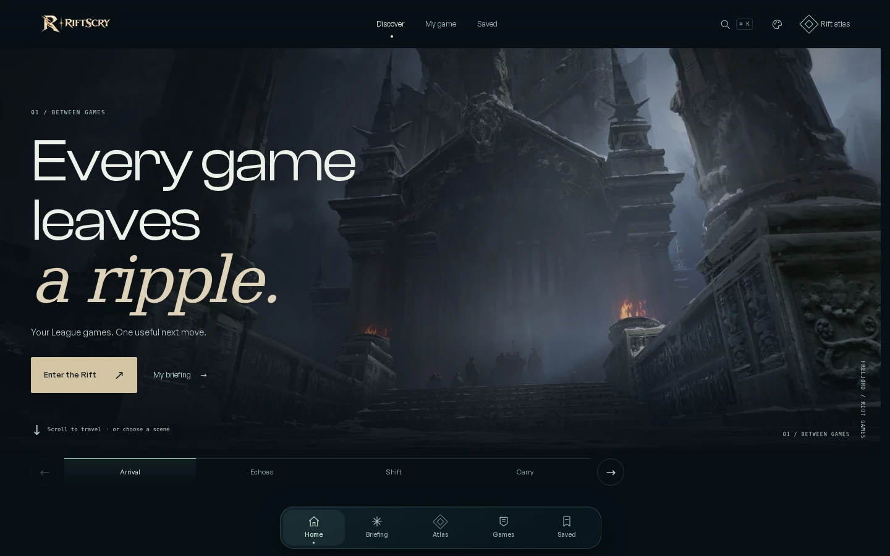
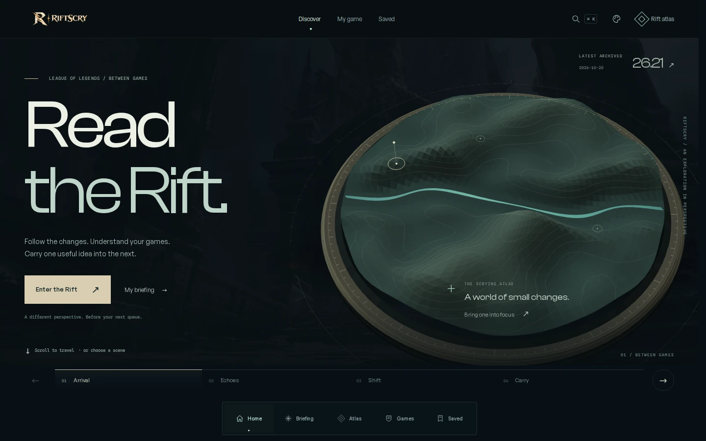
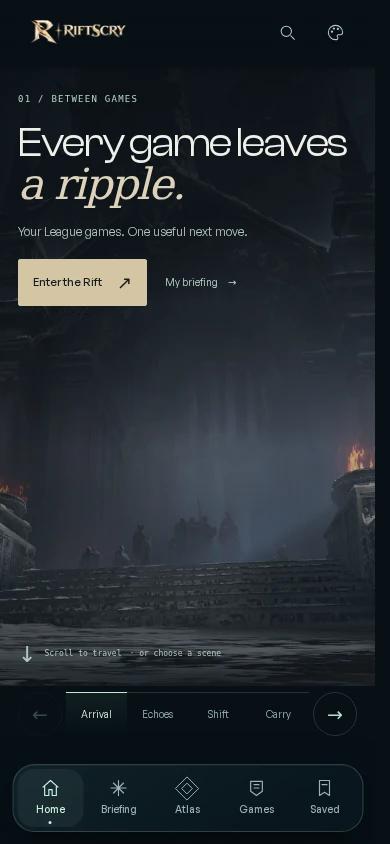
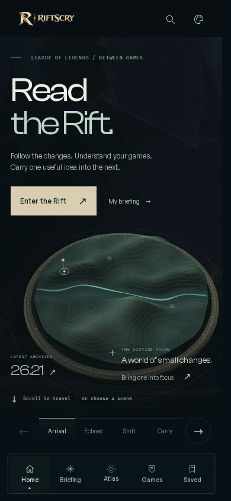

# Read the Rift

Homepage revision, 2 November 2026.

RiftScry's opening uses an original relief atlas as the continuous visual object
across four scenes. Large editorial type, muted stone and metal, an engraved
river, and a focused signal establish its identity. The camera changes viewpoint
as the visitor moves from the invitation to actual archive evidence.

## The product journey

| Scene | What the visitor can do |
| --- | --- |
| Arrival | Enter the champion journey, open the latest archived patch, or continue directly to a personal briefing or remembered reading. |
| Echoes | Choose a featured champion. The selected artwork, marker, archive record, and continuation links update together. |
| Shift | Inspect the champion, ability, patch, exact before/after values, and original Riot source. Keep the finding explicitly or trace its history. |
| Carry | Continue with the same identified record, open kept findings, or enter the briefing. A source-code link gives prospective clients and recruiters a direct route into the project. |

Scene tabs, arrow controls, keyboard, wheel, and touch provide parallel ways to
travel. Ordinary links and browser history remain usable. Returning-player and
archive context stay within the existing application's contracts.

## Implementation

- `src/lib/rift-instrument.ts` authors and projects the decorative relief using
  Canvas2D. Geometry and contours are cached; there is no new runtime dependency.
- `src/scripts/home-world.ts` connects scene changes and champion focus to the
  renderer. Drawing stops when movement settles and while the page is hidden.
- `HomeWorld.astro` includes a static vector fallback. The procedural instrument
  can render before the optional atmosphere image loads, or if that image fails.
- `SignalJourney.astro` and `home-film.css` provide semantic content and responsive
  composition. Exact values, source links, and deliberate saving retain the
  existing application implementation.

The relief is illustrative geography. It does not claim accurate Summoner's Rift
geometry, champion positions, live telemetry, or a gameplay prediction. Official
Riot artwork remains separate from the original procedural illustration.

## Research and review

[Research and design rationale](RESEARCH.md) records the primary references,
publication dates, and decisions drawn from them. It distinguishes recent maker
case studies from the older Igloo reference and makes no claim of universal
originality.

[Pull request #70](https://github.com/ionutn0301/riftscry/pull/70) records the tested
commit, final checks, deployment, and any remaining limitations. Browser fixtures
verify application behavior; they do not establish successful live Riot or AI
account access.

## Before and after

The before captures use unchanged commit
`bb9c7557f4291fcea3ccedaa34f95b3b39ba8b55`. Both sets use the same desktop
1440 × 900 and mobile 390 × 844 viewport sizes with reduced motion for a stable
comparison. The live experience supplies the camera travel.

| View | Before | After |
| --- | --- | --- |
| Desktop |  |  |
| Mobile |  |  |
