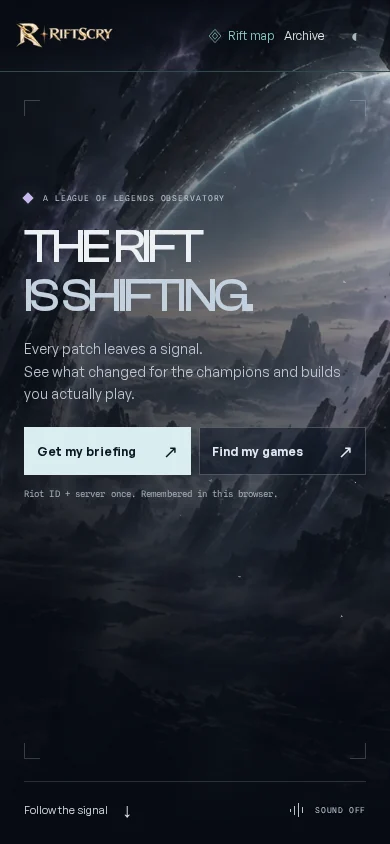
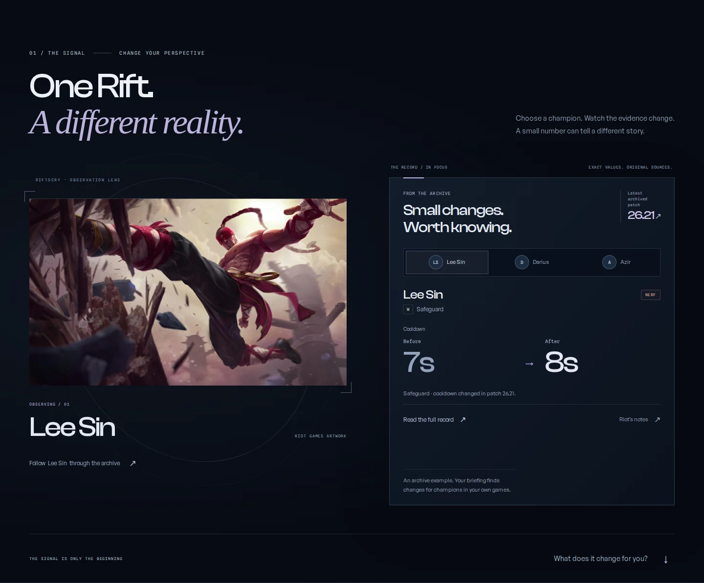
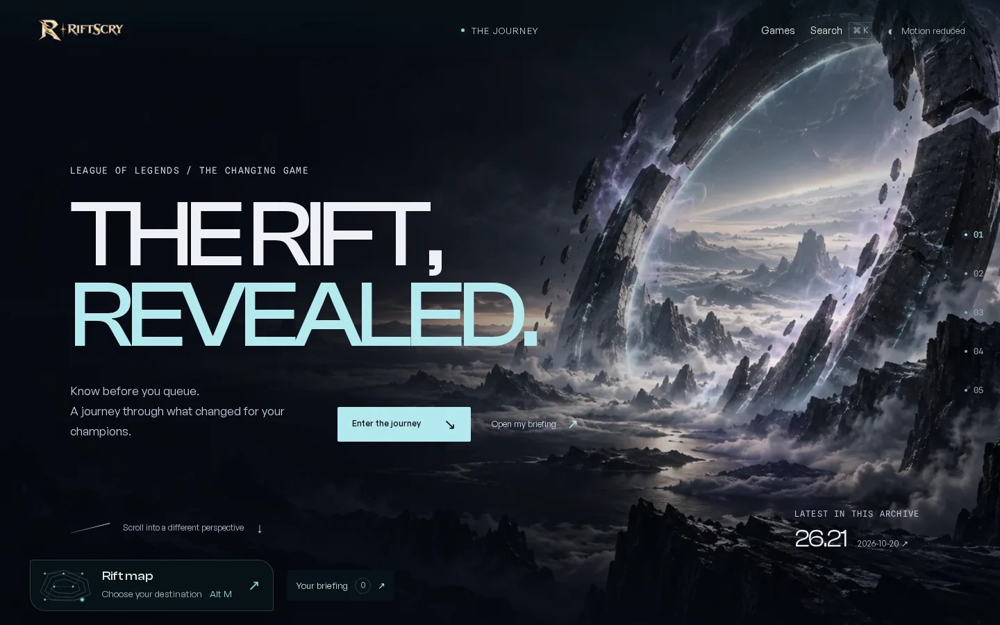

# RiftScry: the cinematic observatory

Design and implementation notes · 29 October 2026

RiftScry's cinematic experience now begins with a landscape and continues into useful patch evidence. The organizing idea is an observatory: enter the Rift, choose a perspective, understand a change, and decide where to go next. The atmosphere supports the existing League of Legends companion, champion archive, and player briefing.

## Research and design decisions

The reference review examined authored project accounts and working interfaces. These examples establish useful design patterns; they are not evidence of market-wide adoption or conversion gains. All sources below were reviewed on **29 October 2026**. Publication dates are included where the source provides them.

| Primary source | Evidence and application |
| --- | --- |
| [Active Theory: the Notturno experience](https://lbbonline.com/news/the-notturno-experience-how-we-built-santioni-spirits-launch), **17 September 2026** | The team concentrated interaction on three consequential story moments and connected its illustrated scenes to information sections. RiftScry similarly gives champion selection a visible consequence: the artwork, exact evidence, and archive destination change together. |
| [Merlin Studio: Rise of the Merlin](https://merlin.studio/work/pendragon-rise-of-the-merlin), undated case study | Composition, deliberate camera movement, environmental detail, and progressive asset loading create a coherent place. RiftScry uses a large establishing image, quiet reading space, and restrained atmospheric motion. |
| [Immersive Garden: Aten7 / Toom Archives](https://immersive-g.com/projects/aten7/), undated case study | An interactive timeline, changing weather, and a persistent fictional environment give exploration continuity. The observatory palette and landscape continue from the homepage into the existing `/explore` journey. |
| [Bruno Simon: portfolio and technical notes](https://bruno-simon.com/), live interface | The experience exposes audio, quality, keyboard, mobile, and recovery controls. RiftScry retains direct navigation and provides motion and sound controls while keeping its useful interface in HTML. |

The resulting direction is specific to patch intelligence: a fractured horizon, an observation lens, and evidence that comes into focus. Native scrolling and chapter links let readers determine the pace. Returning players can go straight to their briefing. There is no timed introduction, artificial loading sequence, or interaction gate before the information.

## Implemented scope

### Homepage: `/`

The arrival frame introduces the observatory with an original environment, large typography, a clear entrance, and the archive's actual patch identifier and date. The label explicitly describes an **archived patch**; the cinematic setting does not imply live game telemetry.

Three chapters connect the opening to the product:

1. **The signal:** selecting a featured champion updates the official artwork, before/after record, classification, original-source link, and destination in `/explore`. Tabs support arrow keys, Home, and End. Inactive panels leave the focus order and accessibility tree.
2. **Your impact:** the existing impact component connects the example to the player's own games and briefing.
3. **Next move:** direct routes support catching up after a break, finding a recorded build, and opening the next-game briefing. An epilogue links to the archive journey and champion roster.

The chapter bar tracks the current section without replacing browser scrolling. Existing homepage journey parameters and chapter links redirect to their corresponding `/explore` location.

### Archive journey: `/explore`

The existing five-chapter journey receives the same arrival environment, typography, light, and material treatment. Its functional sequence remains: enter, choose a champion, inspect a change, follow its history, and prepare a return visit.

Champion selection, recorded-field controls, patch interval selection, exact source records, kept findings, and My Pool remain the substance of the journey. The redesign preserves ordinary links to champion histories, patch comparisons, Riot's notes, and player briefings. It does not introduce speculative win-rate predictions or rewrite archive data.

## Artwork, motion, and sound

The original AI-created environment has separate wide and mobile WebP compositions in `public/images/observatory/`. It provides the scenic backdrop. Champion identities use intact official Riot Games artwork, credited in the interface; they are not generated character reinterpretations.

`rift-field.ts` adds soft spectral light and sparse particles above the server-rendered image. Its two small WebGL passes use no external textures. Rendering targets 30 frames per second with a bounded buffer of approximately 1.15 million pixels, pauses outside the opening scene or a hidden tab, and releases resources on teardown. These are implementation limits, not measured performance results.

The existing motion preference and operating-system reduced-motion setting disable continuous movement and pointer parallax. Static composition and content remain. This follows the control principles described by [W3C's Animation from Interactions guidance](https://www.w3.org/WAI/WCAG22/Understanding/animation-from-interactions.html) and [Pause, Stop, Hide guidance](https://www.w3.org/WAI/WCAG22/Understanding/pause-stop-hide.html), reviewed 29 October 2026.

WebGL initialization or context loss falls back to the illustrated environment. Without JavaScript, the opening, initial archive example, chapter links, and source links remain readable. The `/explore` fallback links to champions, patches, and comparisons; JavaScript-dependent selection and saved-state features still require JavaScript.

Ambient sound starts only after explicit activation. A quiet original synthesized tone bed responds subtly to champion selection, suspends when the tab is hidden, and resets to off when leaving the page. No sound preference causes automatic playback on a later visit.

## Screenshots

Captures from the production build at 1440 × 900 and 390 × 844. Motion is reduced for reproducible screenshots; the signal section is captured in full.

| Homepage, desktop | Homepage, mobile |
| --- | --- |
|  |  |

[Mobile archive journey](screenshots/explore-mobile.webp)

## Verification

Local release checks on 29 October 2026:

| Check | Evidence |
| --- | --- |
| Astro / TypeScript | `pnpm check`: zero errors and zero warnings; two existing hints in unrelated components. |
| Unit and archive-data suite | `pnpm test`: 510 tests passed across 51 files. |
| Production output | `pnpm build`: Astro static pages and Vercel functions built successfully. |
| Focused shared browser suite | 117 passing executions: 39 each on desktop Chromium, mobile Chromium, and mobile WebKit. Covers newcomer/returning-player geometry, 44px targets, storage resilience, stable selection and all six observatory scenarios. |
| Observatory interactions | Artwork/evidence/deep-link synchronization, OS and saved reduced motion, no-WebGL fallback, no-JavaScript content, and real opt-in AudioContext behavior all passed on those three browser projects. |
| Player workflows | All 55 fixture-driven scenarios passed across the complete run and an isolated retry. Six avatar assertions initially encountered a local Data Dragon certificate error; they passed with certificate errors ignored only in a temporary external test configuration. Production TLS settings and repository test settings are unchanged. |
| Visual review | Desktop and mobile homepage and `/explore` captures have no horizontal overflow or JavaScript page errors. Compact portrait and landscape returning-player layouts were checked by the responsive suite. |
| Rendering | The software-rendered desktop smoke check sustained approximately 29.7fps against the 30fps cap. No continuous frames were scheduled in reduced motion or below the opening scene. This is a local measurement, not a performance guarantee for every device. |

The complete shared browser suite and player suite also remain in the existing GitHub CI workflow. Local Chromium used a verified 141 headless shell because the default browser download was unavailable; mobile Safari coverage used WebKit 26.5.

The release targets the existing `riftscry` Vercel project and its existing production environment. Deployment readiness and protected live-page checks are recorded in the release report after publishing. Local fixtures do not establish live Riot or AI-provider availability; this redesign changes no player APIs, credentials, access mode, request budget, or calculations.
