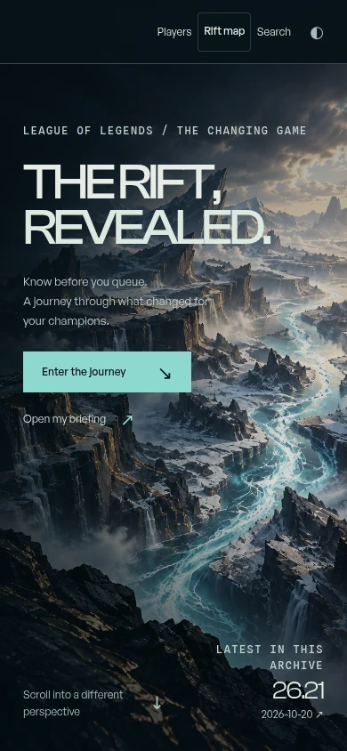
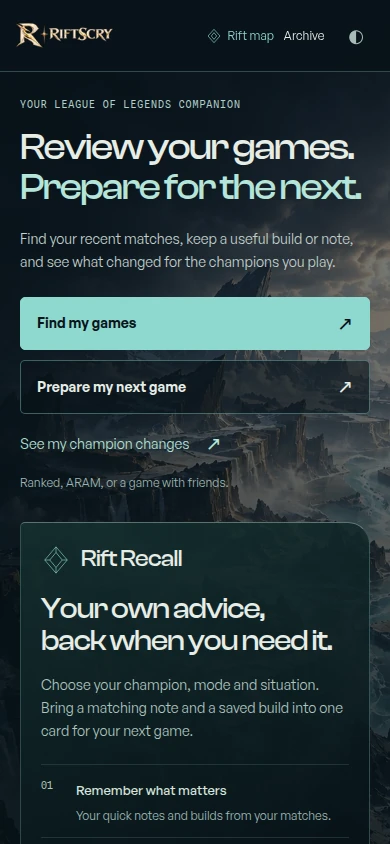
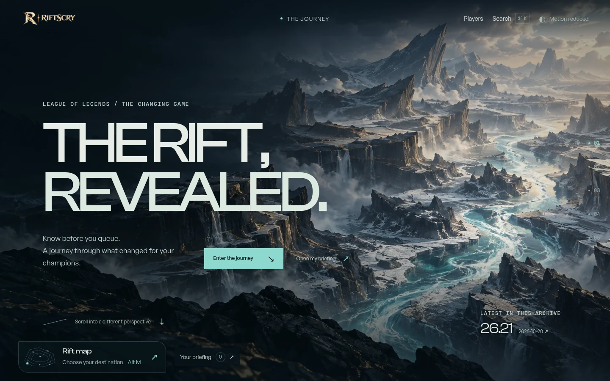
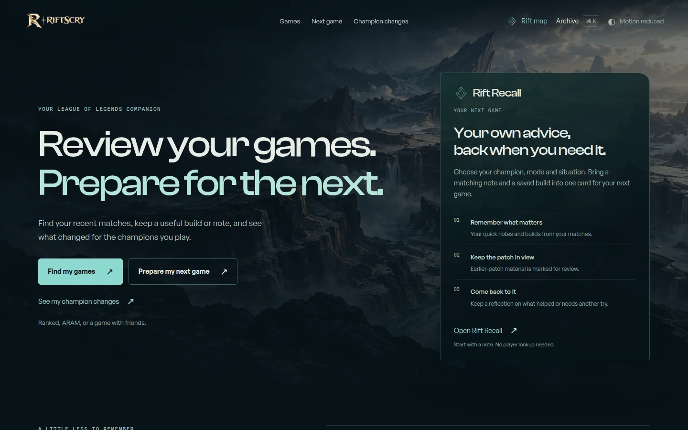
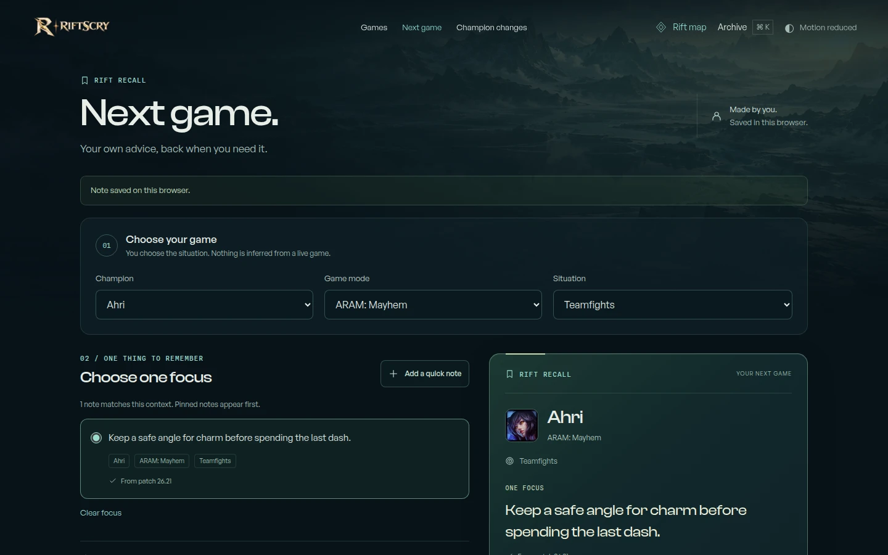
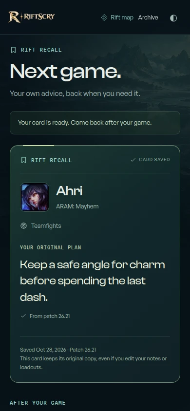

# Companion release audit

## Purpose and shipped experience

**Review your games. Prepare for the next.** The homepage now gives direct access to
recent games, next-game preparation, and champion changes. A validated local shortcut
returns visitors to their remembered player. Homepage and preparation do not request
player data; lookup retains the requested task, such as Your builds or Build Memory.
The immersive archive journey remains at `/explore`, including existing shared links.

**Rift Recall** at `/next-game` matches the player's own notes to a champion, exact
game mode, and manually chosen situation. General notes can apply broadly; pinning
does not bypass context. Players can create, edit, pin, and remove quick notes, or save
and name an observed loadout from their imported matches. Pinned loadouts retain their
source match, final inventory, applicable runes, and original patch.

A game card snapshots the chosen reminder and optional loadout. Later edits do not
rewrite that original plan. Patch review shows relevant available records and keeps
the original patch separate from a reviewed baseline. Afterward, Helped, Try again,
or Did not apply records the player's assessment, with an optional reflection. Notes
alone remain useful for casual and ARAM play; starting a card is optional.

Backup export/import includes a preview, validation, and additive merging that keeps
matching local entries by default. A conflict between unfinished cards is explained
instead of silently dropping one.

## Product rationale

[OP.GG documents private match notes](https://help.op.gg/hc/en-us/articles/30993148799897-Features-available-when-linking-a-Riot-Account),
and [Mobalytics documents goal-based Challenges](https://mobalytics.gg/blog/dev-blog-mobalytics-challenges/).
Rift Recall's design brings context matching, an original plan snapshot, source-aware
patch review, and personal reflection into one browser workflow. This is a product
choice, not a claim of exclusivity or evidence that the feature improves win rate.

## Boundaries

Preparation stays in this browser, without automatic account or device sync. Clearing
browser data removes it. Backups cover Rift Recall notes, loadouts, and cards; champion
pool, archive reading state, and Build Memory adjustments remain separate.

Imported match samples are bounded, not complete season histories. Manual preparation
works when imports are unavailable, including
[Riot's private Mayhem history](https://github.com/RiotGames/developer-relations/issues/1109#issuecomment-3671793822).
This release does not retrieve private matches or infer that a game was played.

Patch and item coverage is partial. Six source headings have explicitly verified item
identities in [the provenance supplement](../../src/data/companion-item-identities.json),
with official notes, item-image IDs, and patch-specific Data Dragon catalogs recorded.
Unreviewed headings and same-name mode variants remain unmapped; names alone do not
establish an item change. Missing patch baselines remain unknown.

## Visual and mobile audit

Local Chromium checks covered **320×568, 390×844, 568×320, 768×1024, 844×390,
1024×768, and 1440×900**. No horizontal overflow or homepage player requests were
observed. All seven map destinations fit without scrolling at these normal text sizes;
all three homepage actions fit above the fold at 320×568. Enlarged text may require
the map's accessible scroll region.

Pairs show `/` before and after this release, with identical dimensions, reduced
motion, loaded fonts/artwork, and no player fixtures. WebP quality is 90.

| Viewport | Before | After |
| --- | --- | --- |
| Phone, 390×844 |  |  |
| Desktop, 1440×900 |  |  |

The new Rift Recall workspace uses a synthetic, manually entered Ahri / Mayhem /
Teamfights reminder. Desktop shows preparation; phone shows the saved original plan.
Both captures start at the top with loaded fonts and artwork. No private profile or
Mayhem match history was retrieved.

| Desktop, 1440×900 | Phone, 390×844 |
| --- | --- |
|  |  |

## Validation

**Player browser suite: 48/48 cases verified.** The initial full run passed 46 cases;
the remaining two passed focused reruns after correction.

| Local release check | Result |
| --- | --- |
| Astro / TypeScript check | 0 errors, 0 warnings; two existing hints |
| Unit and integration suite | 433 passed across 44 files |
| Vercel production build | Passed |
| Production-build desktop and mobile Chromium suite | 161 passed; 13 existing conditional skips |
| Player workflows | All 48 cases verified, as described above |
| New homepage and Rift Recall browser workflows | 44 executions passed within the shared suite |
| Whitespace / patch validation | Passed |

The shared suite includes exact-mode matching, immutable cards, reflection, verified
numeric patch changes, backup conflicts, unavailable storage, cross-tab editing, and
320px layout. Hosted CI also runs mobile WebKit. The release pull request records the
final CI and authenticated Vercel deployment results. Browser emulation and screenshot
inspection do not substitute for physical-device testing.
