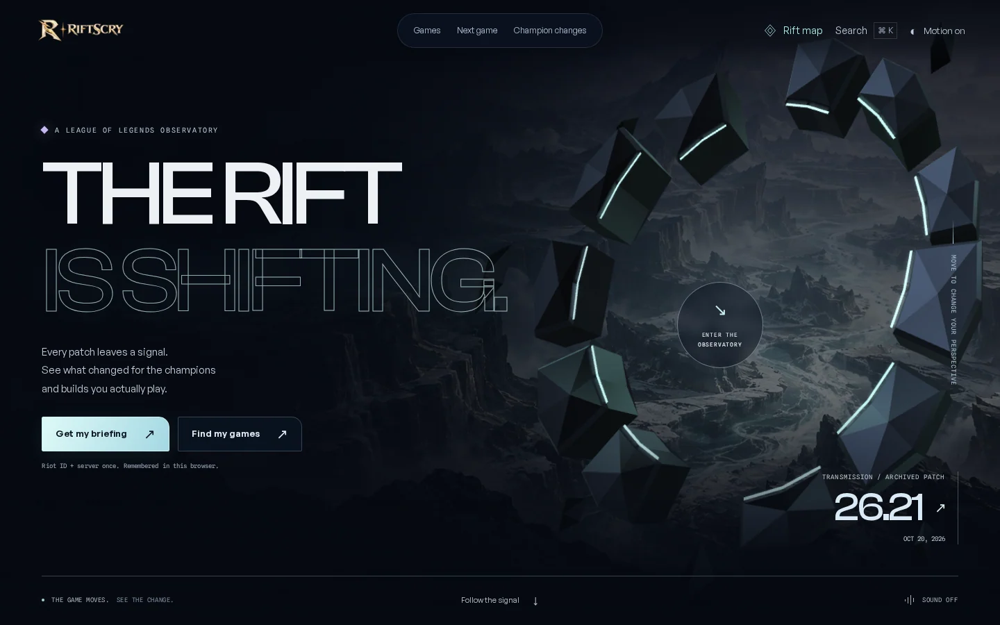
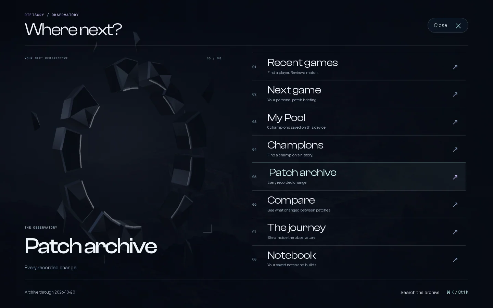
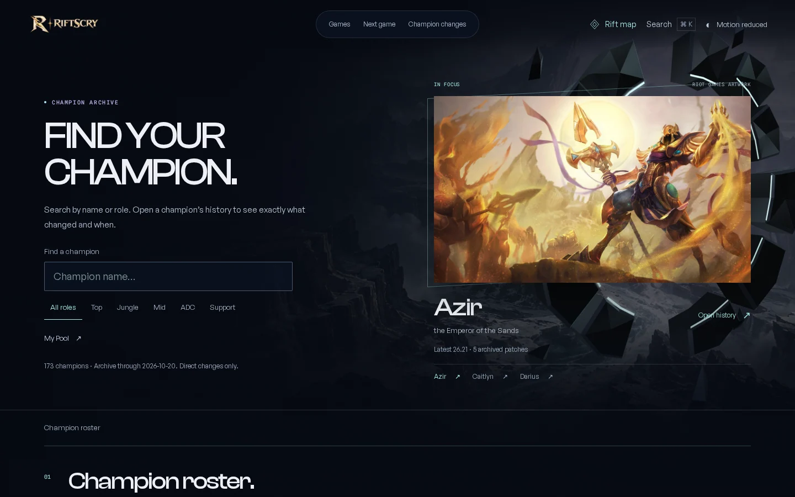
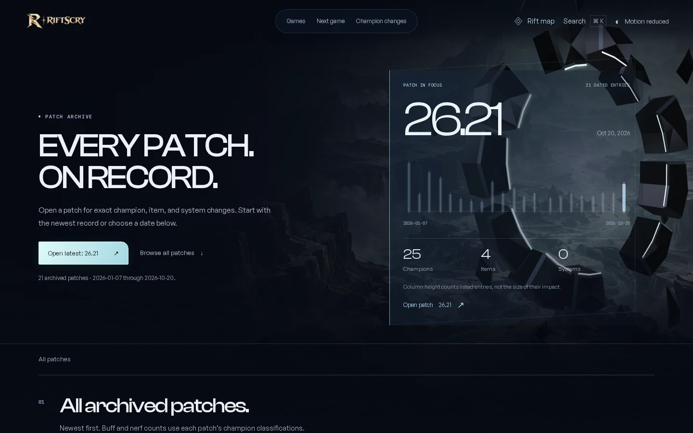
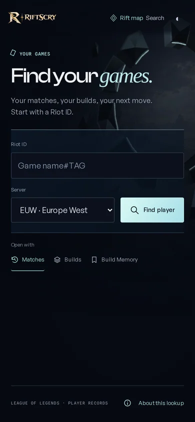
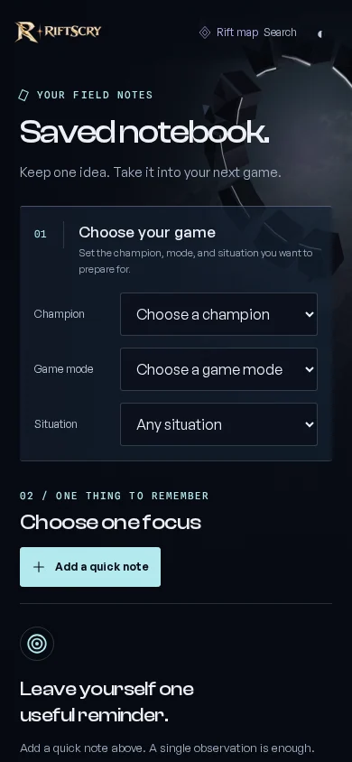
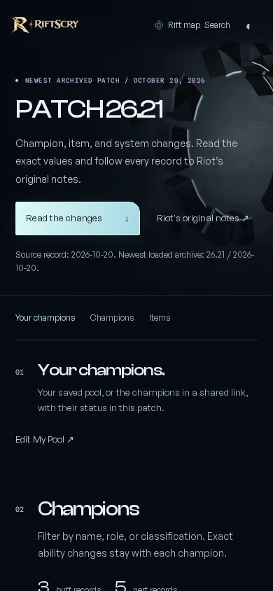

# The living Rift

Design decision record · 29 October 2026

This iteration gives RiftScry a recognizable physical environment across the entire
application. The previous pass unified color, navigation, and page openings, but
repeating a horizon image still made the working pages feel like conventional
layouts with a cinematic background. A shared fractured sculpture now establishes
the place; each destination composes its useful task around a different view of it.

## Research translated into decisions

These primary studio accounts were reviewed on 29 October 2026. They describe the
creators' design intent, not independent performance measurements.

- [Merlin — Rise of the Merlin](https://merlin.studio/work/pendragon-rise-of-the-merlin)
  describes scenes with individual compositions, focal points, and deliberate
  camera movement. This informed distinct page openings and the responsive object,
  while RiftScry retains direct access to its forms and records.
- [OFF+BRAND — Lando Norris](https://www.itsoffbrand.com/our-work/lando-norris)
  ties motion and 3D to the subject's identity and pairs them with direct,
  responsive navigation. The application here is a consistent Rift instrument
  beside ordinary links and controls.
- [Immersive Garden — Aten7 / Toom Archives](https://immersive-g.com/projects/aten7/)
  combines an authored environment with a timeline and procedural changes. This
  informed an archive instrument driven by actual patch dates and entry counts.

The resulting design choices are our interpretation of those examples: one
recognizable object, meaningful selection feedback, and room-specific composition.
The sculpture's colors and motion are decorative; they do not encode player
performance or imply live game telemetry.

## One object, two renderers

[`rift-geometry.ts`](../../src/lib/rift-geometry.ts) defines real 3D vertices,
surface normals, beveled fragments, exposed illuminated edges, and fourteen route
presets. The server projects this geometry into SVG. An optional WebGL renderer
draws the same object with depth, lighting, reflections, and a restrained response
to pointer position and scrolling. The SVG is present before JavaScript runs.

The shared scene lives outside the foreground interface, is hidden from assistive
technology, and cannot receive pointer input. Existing authored environment images
provide distance. Official Riot champion artwork remains intact and contained;
the sculpture and backdrop do not repaint or replace it.

## Selection has a visible consequence

The Rift map is a native dialog containing eight ordinary destination links.
Hovering or focusing a destination updates its description and the shared object's
composition. The underlying foreground is concealed while the map is open, so page
headings and forms do not compete with the preview. Closing restores the route's
scene and the opener's focus. Choosing a destination navigates normally.

The champion directory updates its official splash and archive summary when a row
receives focus, is hovered, or matches an exact normalized search. On desktop, a
second synchronized portrait stays beside the roster as it scrolls; its native
history link opens the selected champion. Mobile keeps the search and list direct
and omits that optional sidebar. Existing search, role filters, and URLs remain.

The patch archive uses actual release dates for horizontal position and the sum of
listed champion, item, and system entries for column height. The caption explains
that counts are not impact scores. Row focus or hover updates the date, counts,
and ordinary patch link. Both readers send selection events to the scene without
moving focus or replacing navigation.

## Fourteen destinations, familiar tasks

Each family receives a scene preset. Desktop can separate sculpture, evidence,
and controls spatially; compact screens keep the first useful control close to the
page heading. The optional journey is not a prerequisite for another task.

| Route family | Opening and working task |
| --- | --- |
| `/` | Title sequence, real archive signals, briefing and game links |
| `/explore` | Guided champion, evidence, history, and return chapters |
| `/players` | Riot ID and server lookup; remembered player and view choice |
| `/players/[platform]/[puuid]` | Player identity, match history, and observed builds |
| `/matches/[matchId]` | Match facts, loadouts, and review navigation |
| `/next-game` | Player lookup followed by the automatic briefing |
| `/notebook` | Champion/context selection, notes, and saved preparation |
| `/champions` | Searchable roster and synchronized champion spotlight |
| `/champion/[id]` | Official portrait and recorded champion history |
| `/patches` | Dated archive instrument and chronological links |
| `/patch/[id]` | Patch scope, changes, and original source links |
| `/compare/[a]/[b]` | Older/newer selection and recorded differences |
| `/pool` | Saved champions, personal catch-up, and daily record |
| Missing route / `/404` | Clear recovery through home and archive search |

The `/patch` and `/compare` shortcuts retain their existing redirect behavior.
This visual iteration adds no backend, player-data dependency, or mandatory step.

## Motion, navigation, and resource limits

Links, browser history, forms, and dialog keyboard behavior remain native. Supported
browsers add document transitions; reduced-motion preferences skip those crossings.
The lifecycle handler consumes an expected native `AbortError` while leaving other
capture or setup failures observable. The outgoing and incoming transition objects
have separate promises, as described in the
[Chrome lifecycle guide](https://developer.chrome.com/docs/web-platform/view-transitions/cross-document).
Both device and saved preferences retain the static scene and avoid allocating
WebGL on initial load. The movement hint appears only with an animated renderer.
Existing sound remains opt-in; the shared scene introduces no autoplay audio.

The renderer targets approximately 30 rendered frames per second, with three draw
passes per frame. At widths up to 700px it caps device-pixel ratio at 1 and the
square buffer at a 480,000-pixel ceiling; larger viewports cap these at 1.5 and
1,050,000 pixels. These are implementation limits, not measured frame-rate or
loading guarantees.

Rendering pauses when the document is hidden, while held in the back-forward
cache, and after scrolling beyond 1.10 mobile or 1.45 desktop viewport heights.
An active map preview can resume it. A missing WebGL context, shader failure, or
context loss leaves the same-geometry SVG visible. Context restoration rebuilds
resources; a noncached page exit releases listeners and graphics resources.
No external 3D engine or new dependency is introduced.

## Capture set

These captures document composition, not loading performance. Populated player
verification uses committed synthetic fixtures, not a private player's account.

## Local verification

Confirmed locally for this iteration:

- `pnpm check`: 0 errors, 0 warnings, and 2 existing hints across 276 files.
- Unit suite: 51 files and 510 tests passed.
- Production build: completed successfully with the Vercel adapter.
- Complete local journey: 40 checks passed, including 28 route/viewport checks,
  six compact lookup states, saved state, synchronized readers, and actual
  desktop/mobile WebGL drawing and motion pause/resume; zero page errors.
- Focused route and chapter-layout verification: 36 checks passed across the
  three browser projects, with zero retries.

Reading destinations have independent test cases and retain their complete
navigation assertions. Layout screenshots export at CSS resolution while the
browser keeps its actual device pixel ratio and motion settings; this bounds
artifact encoding cost without altering the experience under test.

Targeted reader checks were reported passing in the desktop Chromium, mobile
Chromium, and mobile WebKit projects: exact normalized search synchronizes both
champion spotlights; row focus stays on its link; and patch dates, counts, and
destinations match the committed JSON. These are browser-project checks, not
claims about physical-device testing.

The new suites cover the static/no-JavaScript environment, unavailable WebGL,
motion preferences, context and document lifecycle, native map navigation, and
all fourteen route families' first controls. Relevant suites are
[`living-rift.spec.ts`](../../tests/e2e/living-rift.spec.ts) and
[`living-rift-rooms.spec.ts`](../../tests/player-e2e/living-rift-rooms.spec.ts).

The release PR records the final aggregate CI results, tested revision, Vercel
deployments, and live verification. This document records design and local
evidence rather than claiming a particular deployment state.
