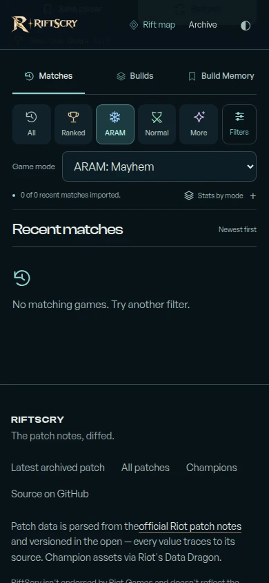
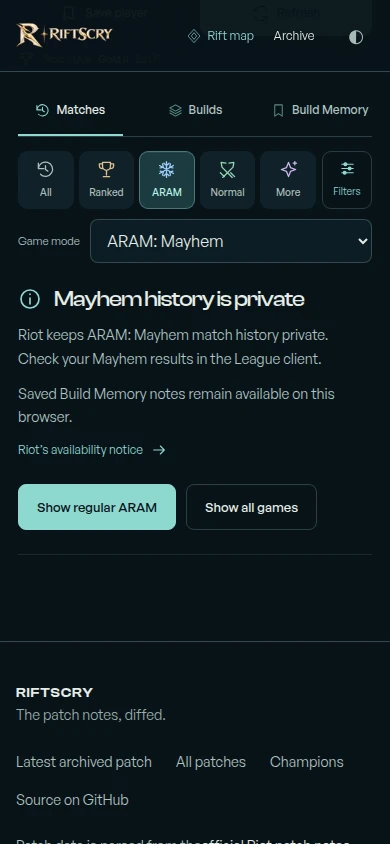
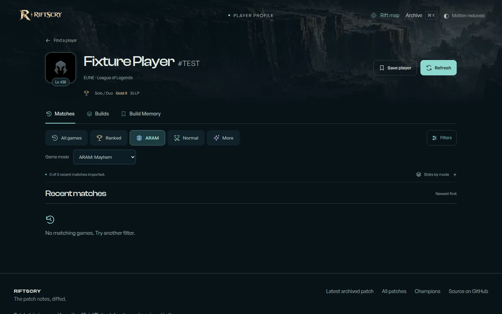
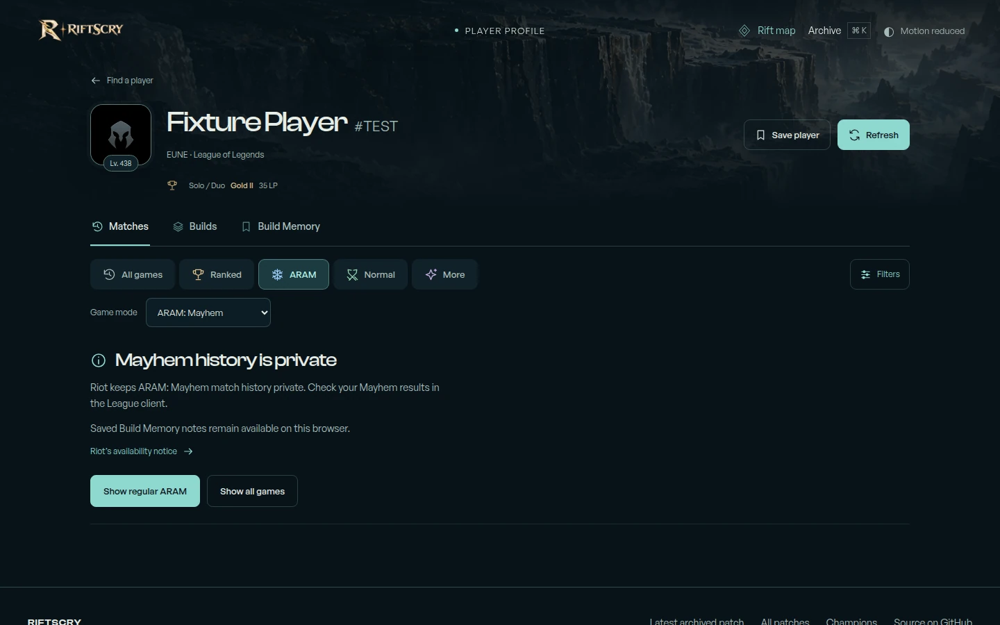

# Mayhem history availability

Visual QA completed on 28 October 2026. The previous empty state presented
ARAM: Mayhem as an ordinary filter with no matches. The updated state explains
the provider restriction, points to the League client, and offers regular ARAM
and All games as recovery actions.

## Source and scope

The explanation links to [Riot's developer-relations notice](https://github.com/RiotGames/developer-relations/issues/1109#issuecomment-3671793822),
posted on 18 December 2025: “Expected behavior. Mayhem matches are private.”
This change explains that restriction; it does not retrieve private Mayhem
history or establish whether a real player has played Mayhem.

The before images use main at
[`949ce7f`](https://github.com/ionutn0301/riftscry/commit/949ce7f026035226f0492e0e3b167668816c3a74)
in a separate detached worktree. The after images use the changes on
`fix/mayhem-history-availability`. Both render the synthetic profile from
[`tests/player-e2e/fixtures.ts`](../../tests/player-e2e/fixtures.ts) at
`/players/eun1/fixture-player-000000000000000000000000000000000?queue=2400&view=history`.
The browser fixture intercepts every `/api/player/**` request and returns an
empty history array for queue 2400. No real player lookup, live Riot profile API
call, or private match retrieval was performed.

## Before and after

Chromium captures use reduced motion, loaded fonts and artwork, and the same
viewport and scroll position for each pair. The phone images are scrolled to
the record tabs beneath the fixed header (`scrollY = 241`); desktop images start
at the top. Images retain their original dimensions and use WebP quality 90.

### Phone — 390 × 844

| Before | After |
| --- | --- |
|  |  |

### Desktop — 1440 × 900

| Before | After |
| --- | --- |
|  |  |

## Observed checks

| Check | 390 × 844 | 1440 × 900 |
| --- | --- | --- |
| Document and body width, before / after | 390px / 390px; no horizontal overflow | 1440px / 1440px; no horizontal overflow |
| Recovery button dimensions | Regular ARAM: 158 × 46px; All games: 131 × 46px | Regular ARAM: 158 × 46px; All games: 131 × 46px |
| Recovery button bounds | Both inside the viewport; bottom edge at 530px | Both inside the viewport; bottom edge at 730px |
| Regular ARAM action | Selects queue 450 and displays the synthetic ARAM fixture | Same |
| All games action | Selects All games and displays the synthetic fixture | Same |
| JavaScript page errors | None | None |

Both recovery actions remove the availability notice. The empty Mayhem capture
requests no match details and shows no fabricated records or statistics.
Behavioral coverage is in
[`mayhem-availability.spec.ts`](../../tests/player-e2e/mayhem-availability.spec.ts).
These captures and checks are local Chromium verification, not a claim that
deployment checks, CI, or physical-device Safari testing have completed.
