# Mobile experience audit

Audit date: **28 October 2026**. Baseline: [`bc6e6ba`](https://github.com/ionutn0301/riftscry/commit/bc6e6baaf483746ea4bb6e79353458a7cff242b8).

The audit covered the homepage journey, shared navigation and search, champion histories, patch and champion archives, comparison controls, My Pool, and player profile/match workflows. It combined browser screenshots, element geometry, scrolling checks, and actual navigation, filtering, selection, and save actions.

## Findings and changes

| Surface | Observed problem | Updated behavior |
| --- | --- | --- |
| Shared mobile controls | The map dock floated over content, while separate header controls competed for the same narrow row. | The map joins a compact header on phones, tablets, short screens, and touch devices. Controls have their own space and safe-area padding. |
| Rift map | At **390×844**, the map had **896px** of scrollable content. Its search footer extended beyond the viewport. | All six destinations, Close, and Search fit at the audited normal text sizes. A single destination region can scroll when enlarged text or a shorter viewport needs it. |
| Homepage chapter navigation | Permanently visible side labels covered champion choices, status text, and artwork. | Compact screens use a labeled chapter index in document flow. Desktop side labels appear on hover or keyboard focus. |
| Homepage composition | Absolute footer positioning competed with actions on short screens. The invitation's hit area also overlapped the desktop map dock at 1280×720. | Compact hero content can grow naturally. Archive links and the invitation have their own space; the short desktop invitation clears the dock by **19px**. |
| Champion selection | The roster dialog and its results both scrolled independently. Reopening could preserve an old scroll position. | One scroll surface, a close control that stays visible, and a reset to the top on reopening. Filtering and selection remain available. |
| My Pool | At **320px**, Support extended to **x=342px**. The role group clipped its contents even though document horizontal overflow measured zero. | All five roles wrap into contained touch targets. The group now has matching client and scroll widths of **274px**. Support can be selected and its results match the committed role data. |
| Narrow champion pages | The two-column hero squeezed long champion names, descriptions, and actions against the artwork. | Narrow heroes stack their content, and actions wrap without crossing the artwork or each other, including the longer saved-state label. |
| Inputs and comparisons | Small field text and intrinsic select widths made mobile editing and comparison controls harder to use. | Active mobile inputs/selects use at least **16px** text, and comparison controls shrink within their available width. |
| Player and match views | Match affordances could exceed their columns; expanded purchase evidence introduced another scrolling pane. | Match columns contain their affordances, mobile fields retain readable sizing, and expanded purchase evidence follows normal page scrolling. Player and roster gutters also account for landscape cutouts. |
| Search handoff | Closing Search after opening it from the map lost the user's focus position. | Search restores focus to the opener after its dialog closes, preserving the underlying page's scroll position. |

Document overflow alone was insufficient: the pool control was clipped inside its own container. The new regressions therefore inspect individual control bounds and exercise the controls as well as checking page width.

## Viewport coverage

| Device shape | Audited viewports |
| --- | --- |
| Phones | 320×568, 360×640, 390×844, 430×932 |
| Tablets | 768×1024, 1024×768 |
| Phone landscape | 568×320, 844×390 |
| Desktop | 1280×720, 1440×900 |

Long content uses normal document scrolling. A compact chapter can extend beyond one viewport when needed to keep its text and controls separate. At **200% text size**, navigation may need an internal scroll; Close and Search retain their own visible regions.

## Before and after

These are matching browser captures from the baseline and updated source. Screenshots use reduced motion for consistent framing. Images retain their original pixel dimensions and are stored as quality-90 WebP; all twelve total approximately **669 KiB**.

### Homepage — 390×844

The chapter labels and bottom map dock leave the content area. The map remains available in the header.

| Before | After |
| --- | --- |
| 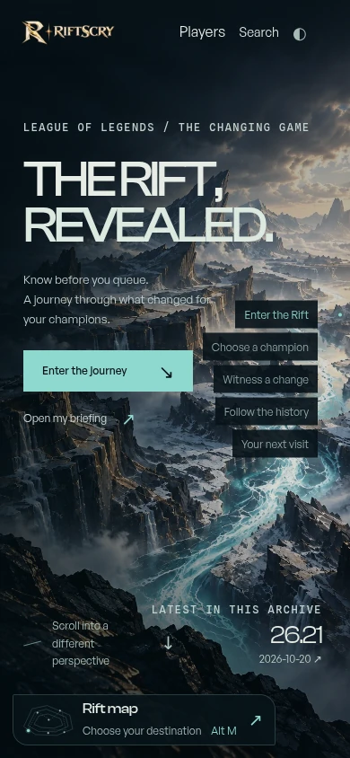 | 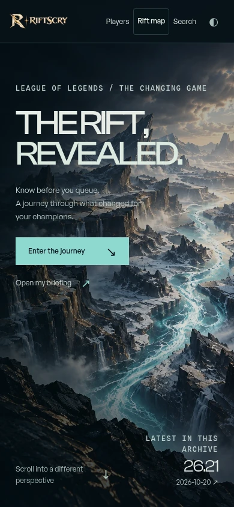 |

### Rift map — 390×844

The baseline footer required scrolling. The updated menu keeps destinations and search available within the viewport.

| Before | After |
| --- | --- |
| 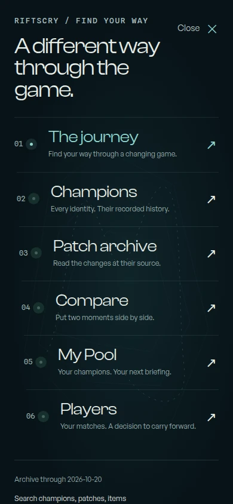 | 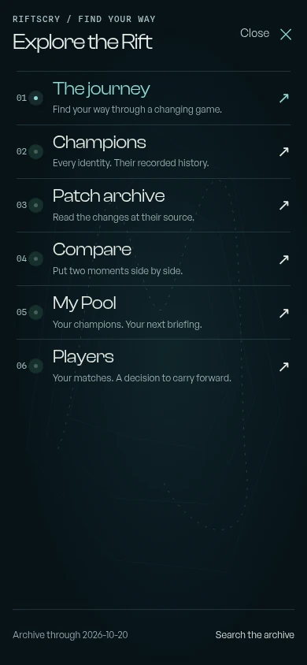 |

### Champion perspective — 390×844

Both captures follow the same **Enter the journey** action. The heading has the same vertical position in each capture; the fixed side labels and bottom dock no longer cover the chapter.

| Before | After |
| --- | --- |
| 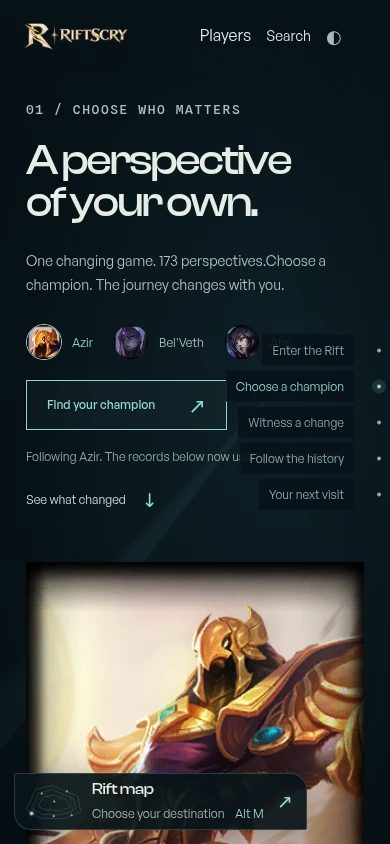 | 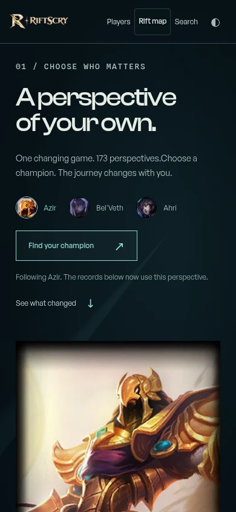 |

### Pool controls — 320×568

Both views are scrolled to the pool controls. Support is fully visible in the updated layout, and the pool status uses the bottom edge instead of floating through the choices.

| Before | After |
| --- | --- |
| 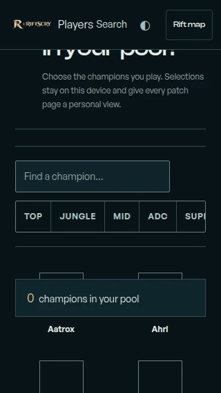 | 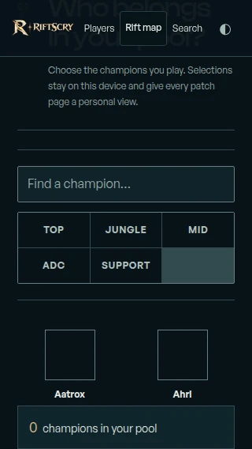 |

### Champion hero — 320×568

The narrow layout gives Aurelion Sol's title, description, and actions a full-width column, followed by the artwork.

| Before | After |
| --- | --- |
| 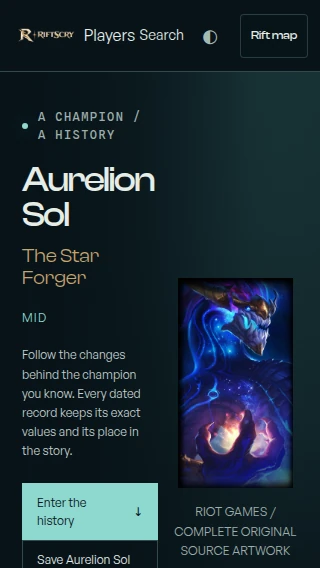 | 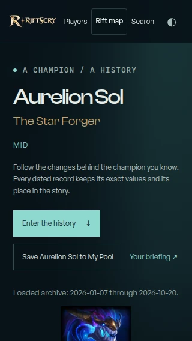 |

### Desktop homepage — 1440×900

The desktop composition remains spacious. Chapter labels are revealed on interaction, and the scroll invitation has more clearance above the map dock.

| Before | After |
| --- | --- |
| 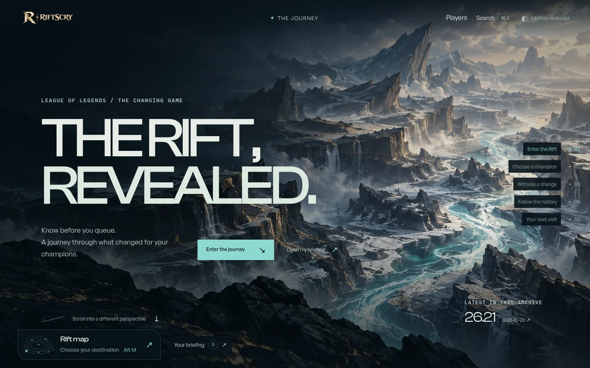 | 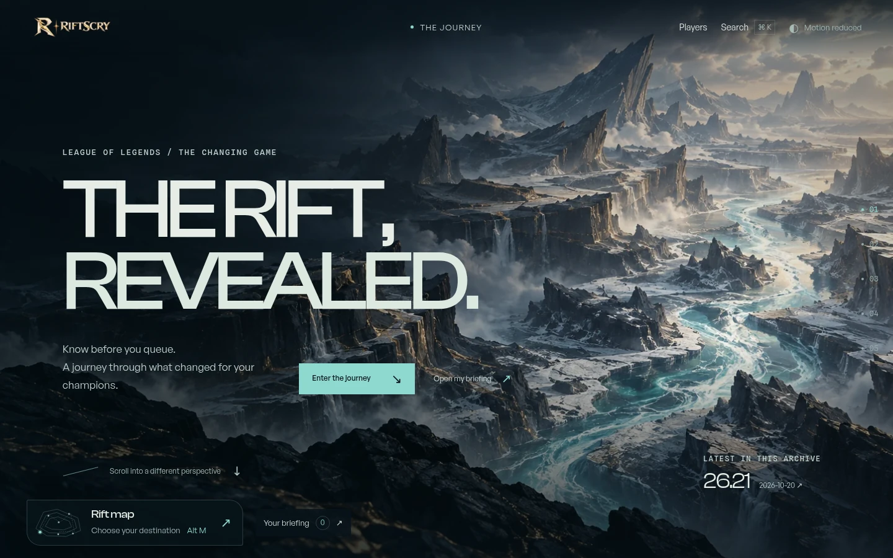 |

## Verification

| Check | Result |
| --- | --- |
| Astro/type checking | **0 errors, 0 warnings**; 2 existing hints |
| Unit and data tests | **415 passed** |
| Production build | Passed |
| Player browser suite | **34 passed** |
| Shared browser suite, desktop + mobile Chromium | **117 passed, 13 intentional skips** |
| Safari/WebKit | Local system dependency installation was blocked by automatic approval review. The existing CI workflow runs the iPhone/WebKit project; see the PR checks for its result. |

The shared [mobile layout regressions](../../tests/e2e/mobile-layout.spec.ts) cover header and chapter overlaps, the map's six destinations, focus and scroll restoration, roster scrolling/filtering, pool role containment, and long champion hero actions. The [player mobile regressions](../../tests/player-e2e/mobile-layout.spec.ts) cover profile controls, match rows, expanded purchase evidence, and readable editing fields. Player browser coverage uses the repository's deterministic API fixtures.

The repository's [CI workflow](../../.github/workflows/ci.yml) installs Chromium and WebKit for the configured browser suites. Local Chromium emulation and screenshot review do not constitute physical-device Safari testing.
