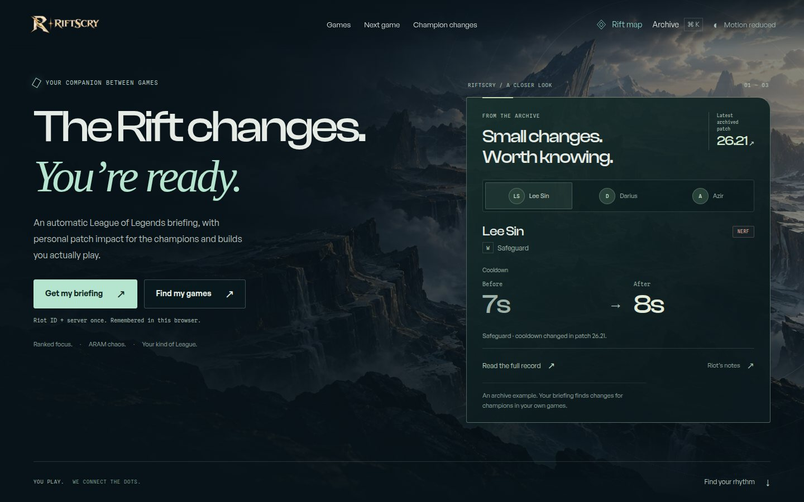
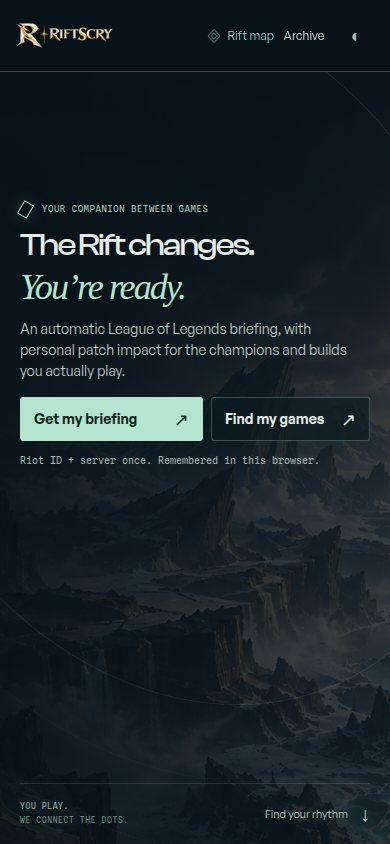
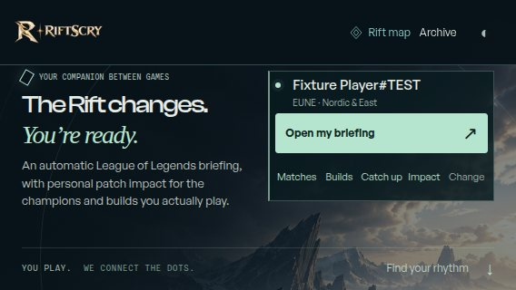

# Viewport and interaction polish

Audit date: 29 October 2026.

The opening banner must fit the available viewport, and changing a champion
must not unexpectedly move the page. This pass addresses those reports and
related defects across the homepage, shared navigation, exploration, champion
pages, player lookup, player profiles, and match detail.

## Findings and fixes

| Finding | Result |
| --- | --- |
| Homepage introduction and full archive card stacked into one over-tall hero. | A viewport-sized opening accounts for the fixed header and safe areas. The archive preview shares the opening on roomy desktops and becomes a separate following section on narrow or short screens. All records and primary actions remain available. |
| Returning-player controls could make the hero taller, especially in landscape. | Height-aware spacing, a landscape composition, and compact shortcut labels keep every action reachable. Long player names use visual ellipsis with the full name retained in accessible text and the title. |
| Restoring a remembered player moved the headline by roughly 66–72px. | The introduction is positioned independently of the launcher's height. Updating the selected player keeps the headline, footer, and scroll position stationary. |
| Switching homepage champions changed the card height by roughly 10–43px. | Panels share an intrinsic grid footprint. Inactive panels remain invisible, inert, and absent from the accessibility tree. Keyboard selection prevents focus-triggered scrolling. |
| Patch-impact selection changed context button width by about 10px. | Selection markers have a fixed width, keeping controls stable through loading and different result sizes. |
| Explore champion selection forcibly scrolled to the section heading. | Selections retain the user's position and focus; chapter links and deep links still navigate deliberately. |
| Rift map scrolled unnecessarily on short desktops. | Compact navigation also applies to short desktop viewports. Close, search, and all seven destinations remain visible in the tested normal-size layouts. |
| Champion artwork overflowed narrow columns by up to 209px. | Intrinsic grid sizing allows the artwork to shrink; the image and wrapped attribution share the available height. |
| Explore and player lookup openings exceeded phone viewports. | Compact portrait spacing and landscape columns fit their content without reducing the tested interactive targets below 44px. |
| Expanded purchase evidence trapped desktop wheel scrolling. | The timeline expands within ordinary page flow, matching the existing touch behavior. |
| Failed homepage portrait downloads showed broken images. | Fixed-size decorative initials remain visible until an image loads successfully, including when a failure occurs before the page script starts. |

## Verification scope

Homepage checks include new and returning players, a deliberately long player
name, portrait/landscape rotation, exact responsive boundaries, button hit
testing, label-in-name accessibility, and the absence of nested hero scrolling.
The viewport matrix covers 320×480, 320×568, 390×844, 480×320, 568×320,
844×390, 768×1024, 1024×768, 1101×879, 1101×880, 1366×768, 1440×900,
1920×880, and 1920×1080.

Shared-route inspection covered `/explore`, `/champions`, `/champion/nunu`,
`/patches`, `/patch/26.21`, `/compare/26.21/26.20`, and `/pool` at seven
viewport sizes. Fixture-driven player/profile/match/briefing inspections
covered 320×568, 390×844, 768×1024, 844×390, 1024×768, and 1366×768.
These checks include long player and champion names.

Focused regressions live in:

- `tests/e2e/home-viewport.spec.ts`
- `tests/e2e/interaction-stability.spec.ts`
- `tests/e2e/responsive-surface-polish.spec.ts`
- `tests/e2e/personal-patch-impact.spec.ts`
- `tests/player-e2e/viewport-polish.spec.ts`

Existing homepage, keyboard, mobile layout, and voyage checks are retained.
The mobile homepage preview assertion now intentionally scrolls to the preview
after first-screen entry checks; selection-focus assertions now check the
original control rather than forced relocation to a heading.

The hero uses a natural content minimum with `svh` sizing. Text enlargement and
unusually constrained windows can extend normal page flow instead of clipping
content or introducing an inner scrollbar. A browser-size matrix cannot
guarantee every device, browser extension, text setting, or virtual keyboard.

## Captures

These are screenshots of the local production build. The returning-player name
is an isolated fixture; no real account is represented. They show the complete
first viewport, without scrolling or cropping the opening content.

